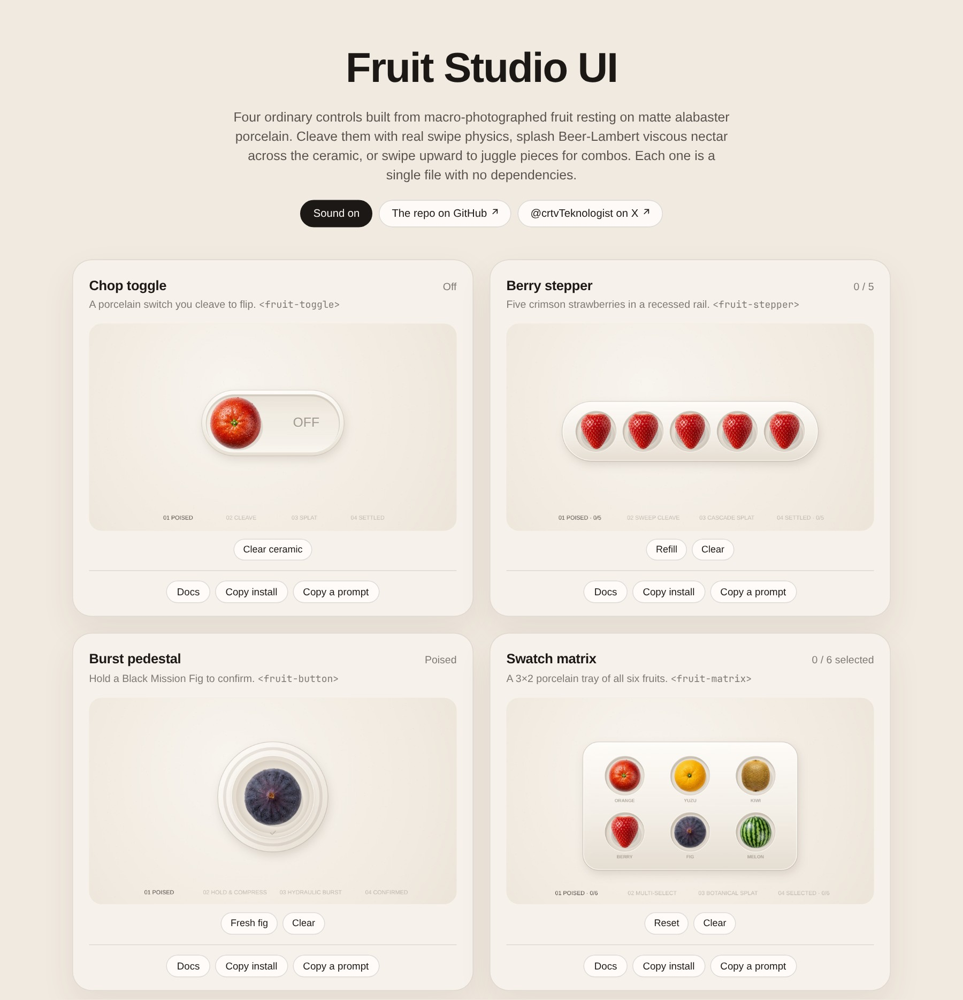

# Fruit Studio UI

Four ordinary UI controls built from macro-photographed fruit resting on matte alabaster porcelain. The toggle is a pill cradling Blood Orange, Yuzu, Kiwi and Watermelon that you cleave to flip. The stepper is a recessed rail of five crimson strawberries you sweep across in a single stroke. The confirm button is a circular pedestal holding a Black Mission Fig that compresses under hydraulic tension until it bursts in 360 degrees. The swatch matrix is a 3×2 porcelain tray uniting all six fruits whose translucent nectar pigments mix on the GPU.

Each control is a single file that defines a custom element, with the WebGL2 viscous nectar engine, synthesized Web Audio foley and photographed WebP fruit sprites inside it, so there is nothing else to fetch. Under each stage is a real accessible control (`switch`, `slider`, `button`, `group`) that works with a keyboard and a `<form>`. No dependencies, no build step for you, MIT licensed.



## The four

| | element | what it does |
|---|---|---|
| [Chop toggle](toggle/) | `<fruit-toggle>` | A binary switch cycling Blood Orange, Golden Yuzu, Fuzzy Kiwi and Watermelon. Swipe to cleave along your exact blade angle and flip the switch; click or press Space / Enter too. |
| [Berry stepper](stepper/) | `<fruit-stepper>` | Five crimson strawberries in sculpted concave dimples (`0`–`5`). Sweep across one to five berries in a single stroke, tap a dimple to toggle it, or step with Arrow keys. |
| [Burst pedestal](button/) | `<fruit-button>` | A Black Mission Fig confirm pedestal. Press and hold for 0.66 seconds as the wine-plum rim fills 360° until it bursts and lights `✓`, or slash across it. |
| [Swatch matrix](matrix/) | `<fruit-matrix>` | A 3×2 multi-select palette of all six fruits. Sweep across any combination to blend translucent nectar pigments on the porcelain; tap any cleaved well to deselect it. |

## The look & physics

Each piece sits on a warm matte-alabaster porcelain stage (`#F1EAE0`) lit from the upper left. The whole and cross-section fruits are macro photographs cut cleanly onto transparency; when cleaved, the two halves render as true off-center 3D spherical caps split along your exact swipe chord and angle, separating with mass-proportional velocity and spin.

The juice is simulated and shaded on the GPU in WebGL2 (`StudioFluidGL`): Beer-Lambert exponential absorption makes thin pooling edges luminous and translucent while deep syrup cores stay rich and glossy, with separate material optical rules for spreading floor pools (`beadness = 0`) and surface-tension micro-beads (`beadness = 1`).

- **Downward or horizontal swipes** cleave the fruit and let the solid halves fall naturally off the bottom edge without vanishing early.
- **Upward swipes** launch only the swiped fruit cleanly upward into upper-frame hang-time — keep your finger down across multiple floating halves and recursively dice them into quarters and eighths for **Double, Triple, Quad, Penta and Hexa COMBO!** scores.
- **Synthesized foley** plays through Web Audio after your first gesture: razor-air whisper, fibrous rind snap, wet viscous splash, ceramic settle clicks and ascending combo harmonics.

## Try them

Live: https://fruit-studio-ui.vercel.app

Or run it yourself:

```sh
python3 -m http.server 8000     # from this folder
# open http://localhost:8000/
```

That opens the gallery with all four controls live.

## Use one

Each is a single file that defines a custom element. Install it with the shadcn CLI, which puts the file in `public/fruit-studio-ui/`:

```sh
npx shadcn add finktheartist/fruit-studio-ui/toggle
npx shadcn add finktheartist/fruit-studio-ui/stepper
npx shadcn add finktheartist/fruit-studio-ui/button
npx shadcn add finktheartist/fruit-studio-ui/matrix
```

Or copy the file into your project by hand. Then load it with a plain script tag and use its element:

```html
<script src="toggle.js"></script>
<fruit-toggle label="Ambient mode" name="ambient"></fruit-toggle>

<script src="stepper.js"></script>
<fruit-stepper value="2" label="Intensity" name="intensity"></fruit-stepper>

<script src="button.js"></script>
<fruit-button label="Confirm publish"></fruit-button>

<script src="matrix.js"></script>
<fruit-matrix name="palette" value="bloodOrange,kiwi"></fruit-matrix>
```

Each folder's README lists every attribute, property, method and event. `<fruit-toggle>`, `<fruit-stepper>` and `<fruit-matrix>` are form-associated custom elements and submit their values inside `<form>`.

- **Size.** Give the element any CSS `width` and its 16:9 height follows automatically. Pointer math maps back into logical coordinates, so CSS `zoom` and transforms work cleanly.
- **Sound.** Plays after the first user gesture. `FruitStudio.Sound.on = false` silences every control on the page.
- **How the files share.** Each file carries the shared core (`core.js`) and only the WebP fruit sprites that control draws (roughly 210 to 630 KB). The first file loaded sets `window.FruitStudio` and every subsequent file reuses the same clock and audio engine.

For coding agents, [llms.txt](llms.txt) lists every file and API. In the gallery each control has a one-click install line and a **Copy a prompt** button.

## Make your own

[`skills/fruit-studio-ui/`](skills/fruit-studio-ui/) packages the workflow as a skill for a coding agent:

```sh
npx skills add finktheartist/fruit-studio-ui
```

It includes `SKILL.md` (the core API, swipe physics rules and verification checklist), `core.js`, `starter.html` (a minimal working porcelain control built on the core) and `look.mjs` (which pauses the shared clock and saves frames side by side). How the set went from concept studies to these four controls is in [making-of/](making-of/).

## Working on this repo

The standalone control files in `toggle/`, `stepper/`, `button/` and `matrix/` are built from source; edit the source parts and rebuild.

- `core.js` holds the WebGL2 nectar engine, 3D fruit physics, Web Audio foley, shared clock and `FruitElement` base class.
- `src/elements/<id>.js` holds each control, and `art/` holds the 384×384 WebP fruit sprites.
- `tools/spec.mjs` describes all four controls once. `node tools/build.mjs` stamps each `<id>/<id>.js` and `skills/fruit-studio-ui/core.js`; `node tools/docs.mjs` generates every folder's `README.md` and `index.html`, `registry.json` and `llms.txt`. Both take `--check`.
- `node tools/test.mjs [URL]` drives every control in the gallery with real touch, pointer and keyboard events at 390 px phone width and checks `FormData`, scaling, sideways scroll and console errors.
- `node tools/shot.mjs URL OUT W H SCALE` takes a clean screenshot (`gallery/title.jpg`).

## Limits

- **WebGL2 for the viscous nectar shader.** Without WebGL2, every control still works and draws its porcelain hardware and 3D split fruits through a 2D canvas fallback without the GPU nectar layer.
- **One canvas per element.** Each element creates its own WebGL2 context, and browsers keep around sixteen alive at once, so use these for hero controls rather than long repeated lists.
- **Touch swipes capture inside the stage.** Because upward swipes launch fruit for mid-air combos, the canvas uses `touch-action: none`; leave padding around the control on phone layouts so visitors can scroll past it.
- **Drawn for a warm light page.** The alabaster porcelain and soft shadows assume a light background (`#F1EAE0` or similar paper tone).
- **Single-file payload.** Photographed WebP fruit sprites make each file 210 to 630 KB; load only the controls you need.
- **Checked in headless Chromium** with real mouse, touch and keyboard events at 390 px width. Not yet tried in Safari or Firefox, on a real phone, or with a screen reader.

## License

MIT. See [LICENSE](LICENSE). The macro fruit sprites and concept studies in `making-of/` were generated specifically for this project.
