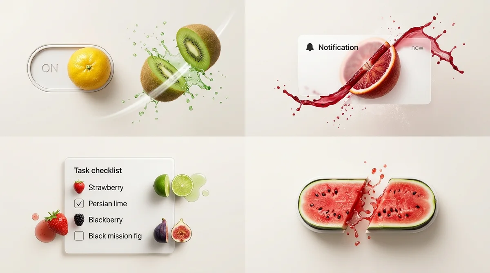
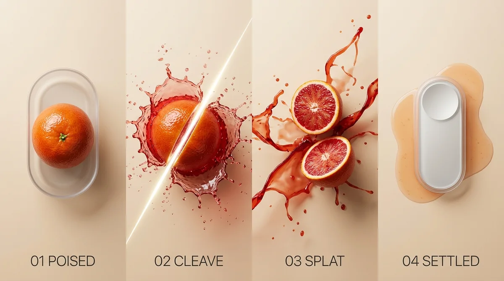
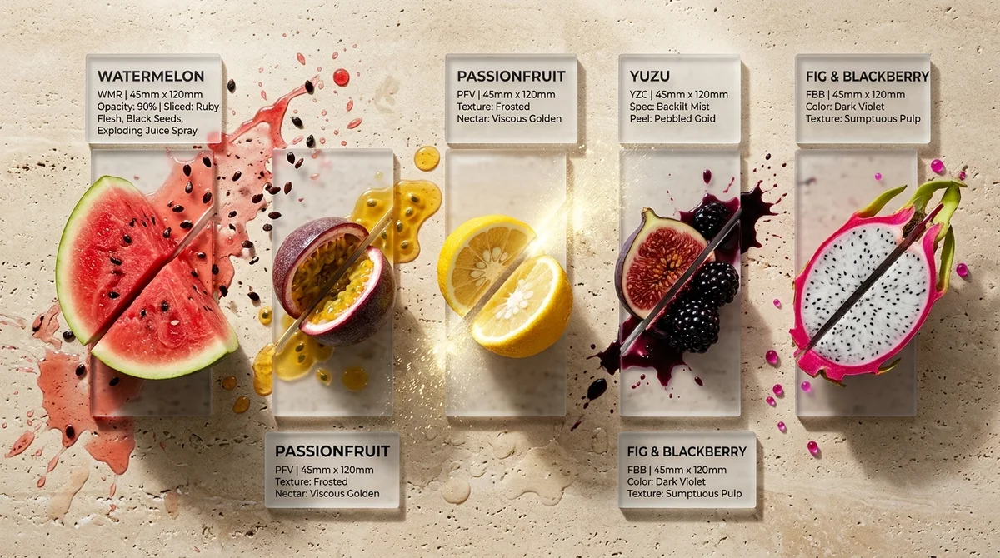
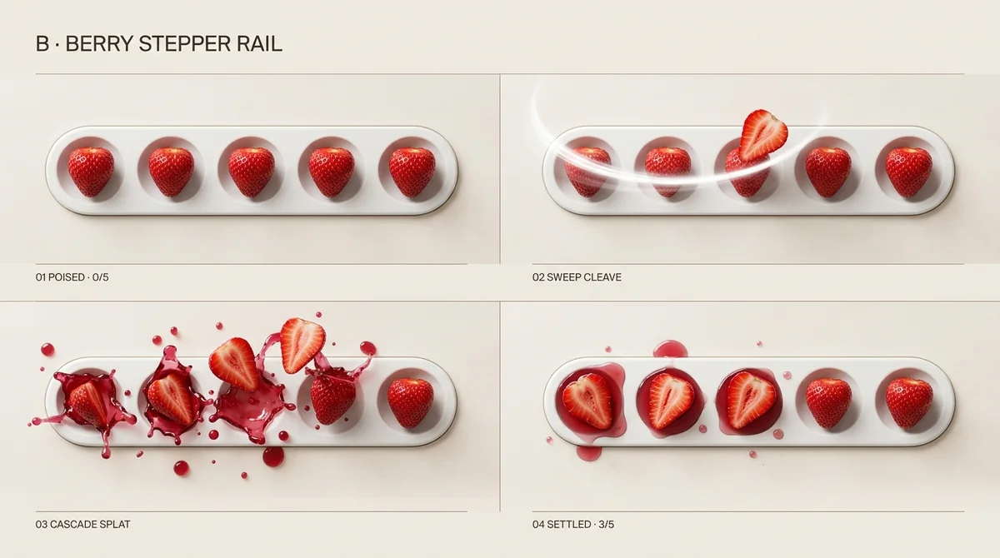
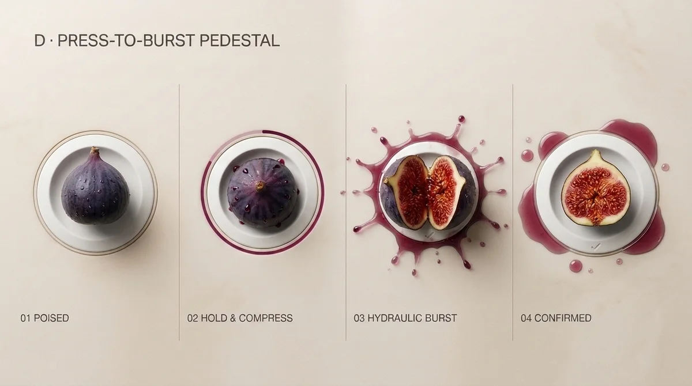

# How it was made

Fruit Studio UI started from a single question: what if ordinary UI controls had the tactile precision of matte alabaster hardware and the wet, physical satisfaction of slicing real macro-photographed fruit on porcelain?

## 1. The material language

We first tested two directions side by side: a warm alabaster studio palette (recessed ceramic troughs, soft studio shadows, high-key natural lighting) and a dark obsidian editorial palette. Alabaster won immediately because translucent fruit juices read like real backlit nectar on pale porcelain — crimson blood orange, golden yuzu, emerald kiwi, ruby strawberry and deep wine-plum fig all keep their luminous color instead of sinking into dark surfaces.

| | |
|---|---|
|  |  |

## 2. Viscous nectar on the GPU

Early 2D canvas splatter attempts looked like flat paint streaks. Studying macro viscous liquid splashes led to the custom WebGL2 fluid optics pass (`StudioFluidGL`):

- **Beer-Lambert exponential absorption** instead of alpha-blended paint: thin edges transmit warm light while deep cores darken cleanly without turning muddy (especially critical for golden yuzu).
- **Two distinct fluid populations** packed into a per-instance `beadness` channel: spreading ceramic pools and scalloped wetting tongues (`beadness = 0`) alongside plump, high-surface-tension millimeter satellite beads (`beadness = 1`) with sharp studio specular glints.
- **RGBA16F floating-point MRT accumulation** so overlapping multi-fruit splashes — like sweeping across all six fruits in the Swatch Matrix — mix pigments organically without clipping into neon bands.

## 3. True swipe physics & the upward combo Easter egg

Every fruit split is computed directly from the user's actual swipe segment across the circle: cut angle, off-center chord offset, spherical-cap mass ratio, swipe speed and blade curvature all drive how the two 3D halves separate and spin.

Three physics notes shaped the final feel:
- **Never fade fruit out in mid-air.** Cleaved halves remain 100% solid and fall naturally off the bottom edge of the stage.
- **Strict per-fruit upward launch.** Only the specific fruit(s) swiped upward (`uy < -0.22`) launch upward into upper-frame hang-time — never unrelated pieces from the bottom edge.
- **Continuous finger-down combos.** Keeping your pointer down across multiple berries, swatch wells or floating halves recursively dices pieces into quarters and eighths with escalating **Double, Triple, Quad, Penta and Hexa COMBO!** points and pentatonic porcelain harmonics.

## 4. Editing the family down to four

Six interactive controls were built and tested end to end, including a 60-minute Citrus Wedge Timer Dial and a Cut-to-Length Melon Slider. Both worked, and both taught the same lesson: slicing works best when a control's job is naturally discrete or tactile — flipping a switch, stepping through five items, holding to confirm a burst, or sweeping a multi-select palette. Continuous minute-by-minute precision fought the cleaving gesture, so the dial and slider were cut before open-sourcing, leaving the four strongest porcelain pieces:

| | |
|---|---|
|  |  |

1. **Chop toggle** (`<fruit-toggle>`)
2. **Berry stepper** (`<fruit-stepper>`)
3. **Burst pedestal** (`<fruit-button>`)
4. **Swatch matrix** (`<fruit-matrix>`)
